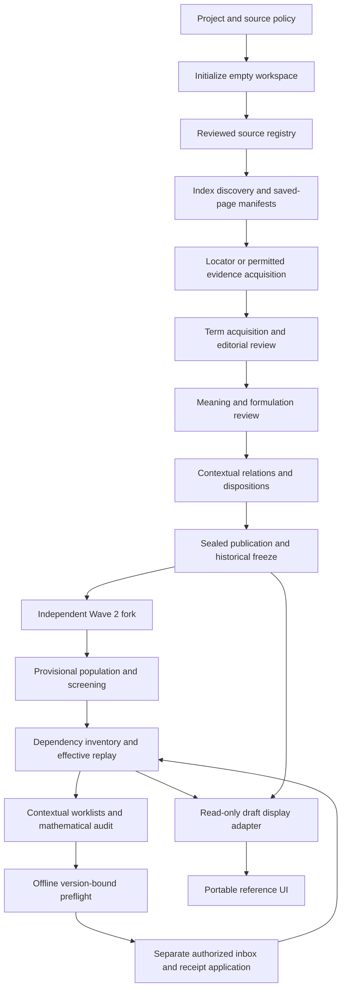

# Independent reconstruction engineering inventory

This is a software audit, not another mathematical audit. Baseline: current main
`0c682bfd`, integrated with PR #11 code at `e978ae4d`. PR #10 head inspected at
`978db08b`; its historical mathematical graph is deliberately not imported.
No PR is merged. The selected optimization branch is
`codex/independent-pipeline-engineering-audit`. The user authorizes engineering
and workflow changes; frozen mathematical records remain outside the read scope.
The only live mathematical dataset used is reconstruction-v2-independent.

The baseline suite ran **218 tests, two expected skips, no failures**. Current
state: 611 meanings, 659 complete scans, 420 unresolved canonical identities,
301 aliases, 771 amendments, 20 seed overrides, consolidation gate false.
Historical canonical review coverage remains 421; it must not be reset to 420.
`CHECKPOINT.json` records exact state and lineage anchors.

## Evolution and stage contracts

Git history places the reusable core's introduction at `ce64fb52` (October 18),
freeze/fork support at `1acbb3fb`, stricter evidence/publication checks at
`0de8dcb3`, full acquisition/review gates at `2189df5e`, `ad183b62`, `c86ae8eb`,
Wave 2 separation at `6378e2e7`, shared UI at `19f440c6` (October 20), and the
persistent dependency engine at `39768ce0` (October 21). Later commits add
amendment replay, receipt-last recovery, aliases, consolidation barriers,
semantic-versus-structural closure, same-mode packet batching, seed overrides,
and version-bound candidate reuse. These are accumulated safeguards, not
obsolete features to discard. Static software coverage includes every Python
module under engine, adapters, UI and evaluation; MODULE_INVENTORY.json records
182 paths, hashes, entry points and imports at the integrated baseline. This
inventory is not a claim of line-by-line semantic verification of every module.

| Stage | Implementation and inputs → outputs | Validation, freshness, provenance and restart |
|---|---|---|
| Empty start / source policy | `engine/cli.py`, `core.Workspace.init`; project profile → project.json, empty records/state, checkpoint | Explicit external-reference mode, schema and stable IDs; refuses reinitialization. No production corpus is a discovery seed. |
| Sources / discovery | `source_manifest.py`, `source_intake.py`, `stage2_actions.py`; vetted source records and approved saved index/sitemap or opt-in HTTPS → task manifests, terms | HTTPS/host, robots/access/rights checks; bounded page size/parser profiles; source and locator-derived IDs. Manifest identity and completed-page checkpoint permit deduplicated restart. |
| Acquisition | `batch_intake.py`, `stage3_locators.py`, `stage3_attempts.py`; terms, saved pages or separately authorized retrieval → locator/paraphrase/permitted-excerpt observations and attempt ledger | Source permission is not citation certification. Full per-term attempts and review gates arose after recovery exposed gaps. Fetching remains opt-in; this audit fetches no academic sources. |
| Original bulk ingest | `core.py`; ordered sources/terms/observations/meanings/relations JSONL → append-only registries and atomic checkpoints | Exact ID/content idempotency, evidence and endpoint checks, fsync boundaries; changed existing IDs rejected. IDs and context, not lexical equality, determine stored identity. |
| Wave 1 recovery / review / freeze | `stage3_recovery_fork`, `stage4_recovery_build/finalize`, `stage3_review_gate`, `stage5_review_gate`, `stage4_finalize`; explicit attempts and editorial ledgers → repaired and sealed snapshots | Recovered stage completeness is not inferred from an older seal. All-term/all-formulation gates and evidence membership required. Frozen records not inspected or regenerated here; Git tree identity protects their unchanged lineage. |
| Versioned revisions / Wave 2 creation | `revisions.py`, `core.fork_second_wave`, `wave2_term_coverage`; frozen lineage → separate unsealed workspace, predecessor-bound revision events | Historical records remain; predecessor hashes and revised seals prevent silent edits. Fork is an explicit operation, not a migration run by this audit. |
| Wave 2 bulk population | `population.py`, `population_queue.py`, adapter population policy/promotion and numbered source/meaning/link tools | Provisional records and review decisions remain separate from screened meanings. Candidate promotion is gated; queue changes must respect dependency phase and breadth hold. Numbered scripts preserve reproducibility and are not removed. |
| Dependency inventory / effective graph | `dependency_graph.py`, `dependency_seed_overrides.py`, mathdef `dependency_scan.py`; records, scans, amendments, aliases, resolutions and seed overrides → inventory, effective nodes, occurrence/candidate/forward/reverse indexes, state/checkpoint | Source/version and occurrence identity, all-or-nothing preflight, replay and receipt-last recovery. Raw scans are historical input, not current nodes. Rebuilds remain global in places; existing same-mode batching avoids per-packet rebuilds. |
| Review worklists / audit | `dependency_context_worklist`, `dependency_global_audit`, `dependency_audit_acceleration`, cycle/provenance/consistency/readiness modules → source/version-bound review leads and bundles | Notation/surface scores never prove identity. Existing-meaning union cycles differ from formulation-choice cycles. Missing dependencies remain open. Exhaustive mechanical readiness does not approve mathematics or a gate. |
| Offline reconciliation / CI | `dependency_review_preflight`, `dependency_review_submit`, package builder, reconciliation status → full-node proposals, digests, preflight output and receipt-derived current status | Exact live occurrence IDs and whole-node hashes; historical seed positions are not edit positions. Explicit application stays separate. PR #11 already carries tested receipt status and dual reference views; reuse them. |
| Publication / independent UI | `core.publication`, mathdef `preview.py`/`preview_site.py`, portable `ui/renderer.py` and JS → separate catalogs, static term/text search, contextual variants, citations, recursive exploration and feedback | Sealed publication checks digests and screening; unsealed Wave 2 uses a clearly labeled read-only draft path. The landing-page builder also reads frozen Wave 1 and therefore is not run against repository data in this audit. Synthetic two-stage fixtures and Wave 2-only temporary output can test rendering. |
| Comparison / resumption / automation | `evaluation/compare.py`, `effort.py`, `resume_checkpoint.py`, adapter resume policy, research workflows | Comparison is an explicit post-freeze tool, never input to independent discovery; tests use synthetic baselines. Resume distinguishes measured evidence from human next steps. Historical stage workflows often duplicate checkout/test/commit/retry logic. No production comparison or graph-writing workflow is run here. |

## Existing optimizations and gaps

Implemented, rather than merely proposed: atomic checkpoints; source/version
hashes; deduplicated source contexts; replayable amendments/seed overrides;
canonical registries and reverse indices; same-mode multi-packet rebuilds;
shared preflight context in review submission; reviewed candidate reuse;
notation-aware nonauthoritative leads; two separate UI presentations; exact
occurrence targeting and receipt-derived reconciliation in PR #11.

The PR #10 efficiency report's early “not yet implemented” sections are
historical: its later sections and actual commits supersede them. The
read-only preflight workflow exists on PR #10, but its runner is inline Python,
its workspace selector can point at any experiment, and its export helper
still performs independent replays per generated packet. Dispatch execution
of that particular workflow is not independently verified here.

Confirmed by code inspection: `core.validate` reloads prerequisite registries
per row (and even per term ID inside a meaning); sealing repeats those reads;
relation validation rebuilds the same formulation-ID set for every relation.
`_ingest_checkpoint` reads the same stage twice. Intake constructs a new
Workspace for every page and does not share a robots cache between fetches.
Offline export does not reuse the review context already supported elsewhere.
Measurements and implementation results belong in RESULTS.md, not this baseline.

## Priorities and compatibility decisions

| Priority | Improvement | Benefit / difficulty / risk | Decision |
|---|---|---|---|
| P1 | Bounded registry/endpoint-index reuse inside one bulk operation | Removes demonstrated repeated parsing; modest code; medium risk to freshness/recovery | Implement with fresh-per-operation cache, unchanged validators, collision/replay/staleness tests and before/after fixtures. No persistent semantic cache. |
| P1 | Reuse existing preflight context in offline export | Avoids one replay per exported packet; small change; low risk for disjoint full-node packets | Implement; keep each packet's simulated nodes isolated and every precondition unchanged. |
| P1 | Reusable read-only preflight runner and thin opt-in workflow | Removes transient execution tests and untested YAML-only logic; medium effort; medium path/artifact risk | Implement with exact workspace isolation in workflow, output containment, fingerprints, immutable input hashes, failure tests and artifacts. No submit credentials or automatic apply. |
| P2 | Shared immutable intake records and robots policy within a batch | Avoid repeated page registry/policy reads; small effort; medium freshness risk | Implement only if scoped reuse remains rights-checked and resumable tests pass. No cross-run retrieval cache. |
| P2 | Review workload budgeting / deduplicated source output | Historical 813 visits versus 468 sources proves potential reading savings; interface coordination needed | Extend existing focus tools in future; do not invent a competing review ledger or truth cache. |
| P2 | Domain-rule adapter for global audit and notation | Current category/module constants and math notation are not generic | Preserve current rules; capture baseline behavior before moving them. Not a justification for a sweeping rewrite. |
| P2 | Consolidate workflow wrappers and CI path filters | Many one-off workflows duplicate orchestration and tiny commits trigger broad tests | Keep historical replay tools; introduce new shared runner first. Broad scheduler/permission migration needs separate integration evidence. |
| P3 | Incremental derived graph materialization / remote evidence cache | Potential large-scale gains, but semantic invalidation and crash recovery are substantial risks | Measure first; preserve authoritative replay and receipts. Do not replace it with a persistent cache based only on mtimes. |

## Domain-neutral assessment

The basic source → observation → contextual meaning → multiple formulations
model already permits formal and context-dependent records; optional metadata
can retain frameworks, measurement conventions or units without new subject
research. It has no general typed evidence-strength or competing-framework
policy yet. The relation_type field alone cannot establish equivalence,
specialization, competing definition, derived prerequisite or shared component.
Add these first to a separately reviewed display/review contract, not silently
to mathematical aliases. Free text and arbitrary metadata are flexibility, not
a validated cross-discipline ontology.

Acquisition already separates manifests, permissions, parser profiles and
workspace records, but source-specific parser dispatch and priority policies
remain scattered. A small explicit source-adapter registry is a future step
once a second real configuration is needed. Discovery/parser reuse must not
carry source approval or mathematics-specific heuristics to another field.

The UI contract already accepts independent groups, contextual meanings,
formulations and source evidence plus branding. Reuse is demonstrated by its
synthetic astronomy tests. Optional notation rendering and context labels can
vary by adapter; preserving search, citations and nested exploration matters
more than renaming files. No new domain site or corpus is created here.

Wave 1 and Wave 2 share registry APIs; recovery, provisional admission and
ongoing dependency reconstruction differ in stage policy. Express future
policy choices through existing config/adapter boundaries, but do not erase
provenance/freeze semantics to force one mode. Empty-start mechanical
initialization is reproducible; scholarly research and editorial judgments
remain external inputs and cannot be regenerated from scripts alone.

Transparent contribution requires exact source versions, reviewed roles,
uncertainty, append-only decisions and receipt-derived current status. Larger
data should amortize byte parsing and evidence presentation while preserving
per-occurrence judgment. Automated synonym suggestions must remain leads.
